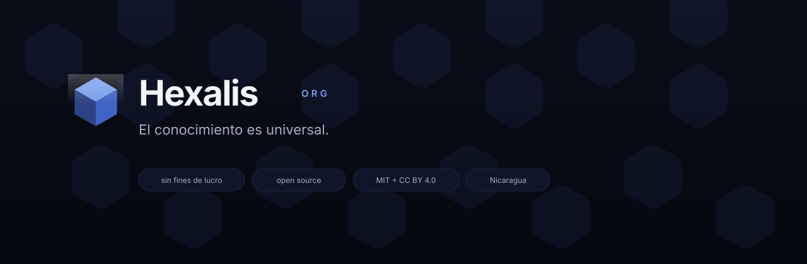
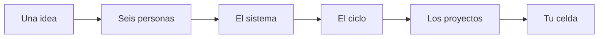

  

  <strong>El conocimiento es universal.</strong> 
  Knowledge is universal.

  Hexalis es una organización sin fines de lucro que diseña y programa proyectos open source, 
  para que cualquier persona pueda usar, estudiar y mejorar lo que hacemos.

  <a href="https://hexalis.org">hexalis.org</a>
  ·
  <a href="https://www.figma.com/design/8Fg5IHgcKSlgQefIhm2MxQ">Design System</a>
  ·
  <a href="https://www.figma.com/design/bebQIgCgYTS57nV4rSV6UP">Toolkit</a>

---

## Visión

Archivos de Figma, código, documentación y las decisiones detrás de cada pieza quedan públicos, con licencias que permiten usarlos incluso en proyectos comerciales.

| Principio | Qué significa aquí |
| --- | --- |
| Open source por defecto | Archivos, código y decisiones públicas, con licencias claras. |
| Documentado de principio a fin | Cada pieza explica cómo usarla y por qué existe. |
| Accesible como objetivo | WCAG 2.2 AA como meta, en modo claro y oscuro. |

Nacimos en Nicaragua. Lo que hacemos es para cualquier persona, en cualquier lugar.

---

## Lo que puedes usar hoy

Dos librerías que encajan entre sí. Puedes usarlas juntas o por separado, en proyectos personales o comerciales.

<table>
  <tr>
    <td width="50%" valign="top">
      
       
      <strong>Hexalis Design System</strong> · v1.0.0 
      85 componentes · 6 paletas · claro y oscuro · 1.614 variantes en Figma 
      Colores, tipografía, componentes y patrones que cada producto extiende con su propia paleta. 
      <a href="https://www.figma.com/design/8Fg5IHgcKSlgQefIhm2MxQ">Abrir en Figma</a>
    </td>
    <td width="50%" valign="top">
      
       
      <strong>Hexalis Design Ops Toolkit</strong> · v1.0.0 
      16 plantillas · 6 kits · 112 componentes 
      No diseña tu producto: te da una forma consistente de investigar, anotar, documentar y entregar. 
      <a href="https://www.figma.com/design/bebQIgCgYTS57nV4rSV6UP">Abrir en Figma</a>
    </td>
  </tr>
</table>

**Cómo empezar con el Design System**

1. Duplica el archivo en Figma y empieza en la página Map.
2. Elige una paleta sin tocar los componentes.
3. Copia los valores a tu código: son variables CSS que empiezan con `--hx-`.

**Cómo empezar con el Toolkit**

1. Duplica el Toolkit en Figma.
2. Copia la plantilla de la fase en la que estás.
3. Reemplaza cada texto entre `[corchetes]`.

Los repositorios de código se abren pronto.

---

## En marcha

| Estado | Proyecto | Qué es |
| --- | --- | --- |
| En desarrollo | Visor de eventos naturales | Una herramienta para explorar los datos abiertos de eventos naturales de la NASA, creada para el NASA Space Apps Challenge 2026 con Hexalis Design System. |
| En diseño | Portal Hexalis | [hexalis.org](https://hexalis.org), diseñado con nuestro propio sistema y documentado con el Toolkit. |
| Abierto | Tu proyecto | ¿Tienes una idea útil para la comunidad? Proponla y la construimos juntos, como open source. |

No estamos afiliados a la NASA ni contamos con su respaldo.

Cada celda es alguien del equipo o un proyecto. Al final queda una celda libre: la tuya.

---

## Súmate

Elige cómo quieres participar. Las librerías ya están en Figma.

- **Si diseñas.** Duplica las librerías y propón componentes o mejoras.
- **Si programas.** Sigue esta organización. Te avisamos cuando haya tareas abiertas.
- **Si representas una organización.** Colabora con un proyecto, propón uno nuevo o apoya nuestro trabajo.

Sitio: [hexalis.org](https://hexalis.org) · Inglés: [hexalis.org/en](https://hexalis.org/en/)

---

## Licencias

Código y variables de diseño bajo [MIT](https://opensource.org/licenses/MIT). Diseño y documentación bajo [CC BY 4.0](https://creativecommons.org/licenses/by/4.0/). Ambas permiten uso comercial; CC BY 4.0 pide dar crédito a Hexalis.
