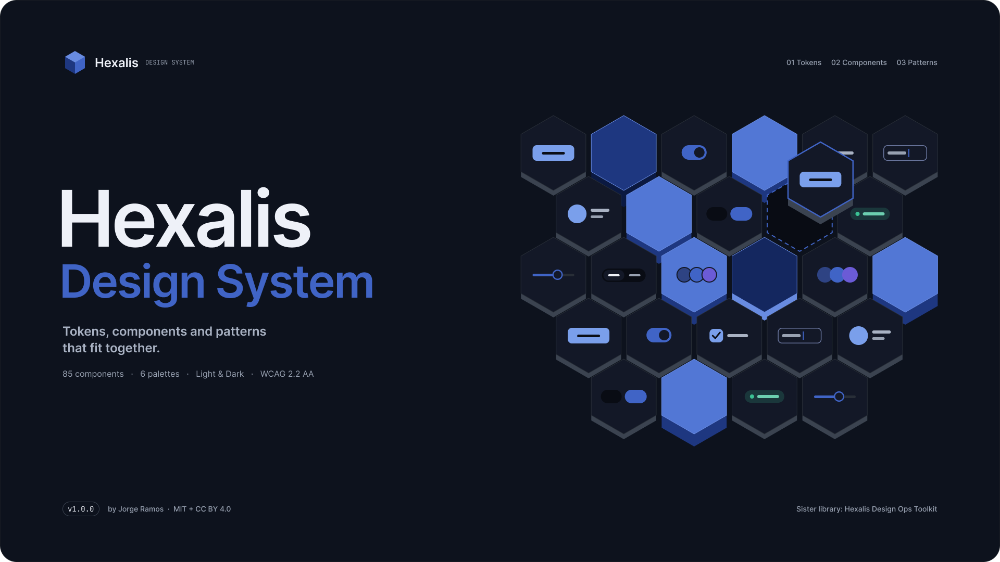
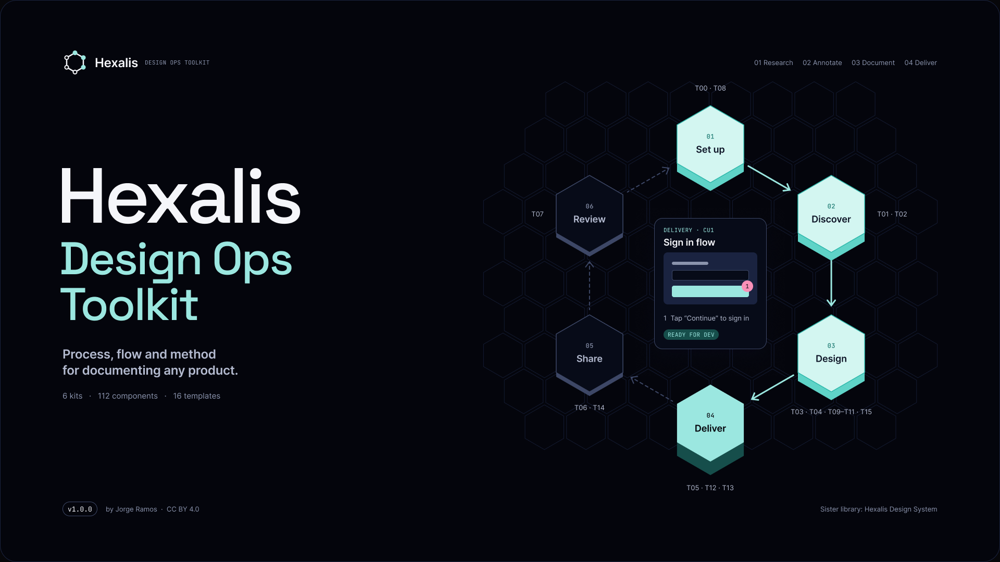

<a href="https://hexalis.org">
  <picture>
    <source media="(prefers-color-scheme: dark)" srcset="assets/hero-dark.svg">
    <source media="(prefers-color-scheme: light)" srcset="assets/hero-light.svg">
    
  </picture>
</a>

  
  
  
  
  

  Hexalis diseña y programa proyectos <b>open source</b> para que cualquier persona pueda <b>usar, estudiar y mejorar</b> lo que hacemos. 
  Somos una organización sin fines de lucro. Nacimos en Nicaragua; lo que hacemos es para cualquier lugar.

  <a href="#lo-que-puedes-usar-hoy"><b>Librerías</b></a>
  &nbsp;·&nbsp;
  <a href="#en-marcha"><b>En marcha</b></a>
  &nbsp;·&nbsp;
  <a href="#bitácora"><b>Bitácora</b></a>
  &nbsp;·&nbsp;
  <a href="#el-equipo"><b>Equipo</b></a>
  &nbsp;·&nbsp;
  <a href="#súmate"><b>Súmate</b></a>
  &nbsp;·&nbsp;
  <a href="#in-english"><b>English</b></a>

<picture>
  <source media="(prefers-color-scheme: dark)" srcset="assets/stats-dark.svg">
  <source media="(prefers-color-scheme: light)" srcset="assets/stats-light.svg">
  
</picture>

<picture>
  <source media="(prefers-color-scheme: dark)" srcset="assets/divider-dark.svg">
  <source media="(prefers-color-scheme: light)" srcset="assets/divider-light.svg">
  
</picture>

## Visión

Archivos de Figma, código, documentación y las decisiones detrás de cada pieza quedan públicos, con licencias que permiten usarlos incluso en proyectos comerciales.

<table>
  <tr>
    <td width="33%" valign="top">
      <h3>⬡ Open source por defecto</h3>
      Archivos, código y decisiones públicas, con licencias claras.
    </td>
    <td width="33%" valign="top">
      <h3>⬡ Documentado de principio a fin</h3>
      Cada pieza explica cómo usarla y por qué existe.
    </td>
    <td width="33%" valign="top">
      <h3 id="accesibilidad">⬡ Accesible como objetivo</h3>
      WCAG 2.2 AA como meta, en modo claro y oscuro.
    </td>
  </tr>
</table>

## Lo que puedes usar hoy

Dos librerías que encajan entre sí: un sistema de diseño para construir productos y un kit para documentarlos. Puedes usarlas juntas o por separado, en proyectos personales o comerciales.

<table>
  <tr>
    <td width="50%" valign="top">
      <a href="https://www.figma.com/design/8Fg5IHgcKSlgQefIhm2MxQ">
        <picture>
          <source media="(prefers-color-scheme: dark)" srcset="assets/ds-cover-dark.png">
          <source media="(prefers-color-scheme: light)" srcset="assets/ds-cover-light.png">
          
        </picture>
      </a>
      <h3>Hexalis Design System <code>v1.0.0</code></h3>
      <b>85</b> componentes · <b>6</b> paletas · claro y oscuro · <b>1.614</b> variantes  
      Colores, tipografía, componentes y patrones que cada producto extiende con su propia paleta.  
      <a href="https://www.figma.com/design/8Fg5IHgcKSlgQefIhm2MxQ"><b>Abrir en Figma →</b></a>
    </td>
    <td width="50%" valign="top">
      <a href="https://www.figma.com/design/bebQIgCgYTS57nV4rSV6UP">
        <picture>
          <source media="(prefers-color-scheme: dark)" srcset="assets/ops-cover-dark.png">
          <source media="(prefers-color-scheme: light)" srcset="assets/ops-cover-light.png">
          
        </picture>
      </a>
      <h3>Hexalis Design Ops Toolkit <code>v1.0.0</code></h3>
      <b>16</b> plantillas · <b>6</b> kits · <b>112</b> componentes  
      No diseña tu producto: te da una forma consistente de investigar, anotar, documentar y entregar.  
      <a href="https://www.figma.com/design/bebQIgCgYTS57nV4rSV6UP"><b>Abrir en Figma →</b></a>
    </td>
  </tr>
  <tr>
    <td valign="top">
      

        
<b>Cómo empezar con el Design System</b>

        <ol>
          <li><b>Duplica</b> el archivo en Figma y empieza en la página Map.</li>
          <li><b>Elige una paleta</b> sin tocar los componentes.</li>
          <li><b>Copia los valores a tu código:</b> son variables CSS que empiezan con <code>--hx-</code>.</li>
        </ol>
      

    </td>
    <td valign="top">
      

        
<b>Cómo empezar con el Toolkit</b>

        <ol>
          <li><b>Duplica</b> el Toolkit en Figma.</li>
          <li><b>Copia</b> la plantilla de la fase en la que estás.</li>
          <li><b>Reemplaza</b> cada texto entre <code>[corchetes]</code>.</li>
        </ol>
      

    </td>
  </tr>
</table>

### Seis paletas, los mismos componentes

Cada producto elige la suya sin tocar los componentes.

<picture>
  <source media="(prefers-color-scheme: dark)" srcset="assets/palettes-dark.svg">
  <source media="(prefers-color-scheme: light)" srcset="assets/palettes-light.svg">
  
</picture>

> [!TIP]
> No necesitas un plan de pago de Figma para empezar. Con el plan gratuito trabajas dentro de tu copia del archivo; con un plan Professional o superior puedes publicarlo como librería de equipo.

Los repositorios de código se abren pronto. Sigue la organización para enterarte.

## En marcha

| | Proyecto | Qué es |
| :-- | :-- | :-- |
|  | **Hexalis Design System** | 85 componentes en claro y oscuro, con 6 paletas. |
|  | **Hexalis Design Ops Toolkit** | 6 kits y 16 plantillas para documentar cualquier producto. |
|  | **Visor de eventos naturales** | Una herramienta para explorar los datos abiertos de eventos naturales de la NASA, creada para el NASA Space Apps Challenge 2026 con Hexalis Design System. |
|  | **Portal Hexalis** | [hexalis.org](https://hexalis.org), diseñado con nuestro propio sistema y documentado con el Toolkit. |
|  | **Tu proyecto** | ¿Tienes una idea útil para la comunidad? Proponla y la construimos juntos, como open source. |

> [!NOTE]
> Participamos en el NASA Space Apps Challenge con un proyecto propio que usa datos abiertos de la NASA. No estamos afiliados a la NASA ni contamos con su respaldo.

## Bitácora

**Dos ideas, una organización.** En 16 días, dos librerías que nacieron por separado se volvieron Hexalis.

<picture>
  <source media="(prefers-color-scheme: dark)" srcset="assets/timeline-dark.svg">
  <source media="(prefers-color-scheme: light)" srcset="assets/timeline-light.svg">
  
</picture>

  
Ver la bitácora en texto

| Fecha | Librería | Qué pasó | Versión |
| :-- | :-- | :-- | :-- |
| 3 oct 2026 | Organización | Se crea Hexalis en GitHub para reunir los proyectos del equipo. | |
| 11 oct | Toolkit | Primera versión del kit de documentación, entonces con otro nombre. | `v1.0.0` |
| 12 oct | Design System | Arranca el sistema: base, fundamentos y componentes esenciales. | `0.1 → 0.3` |
| 12 oct | Toolkit | Cuatro versiones en un día. | `1.3 → 2.2` |
| 14 oct | Design System | Componentes avanzados, gráficos e ilustraciones, hasta la primera versión estable. | `0.4 → 1.0` |
| 15 oct | Design System | Plan v2: limpieza y fundamentos completos. | `1.1 → 2.0` |
| 18 oct | Toolkit | El kit cambia de nombre: el anterior ya lo usaban otros productos. | `3.0.0` |
| 19 oct | Organización | Las dos librerías se vuelven Hexalis y reinician en v1.0.0, cada una con sus propias variables, para usarse juntas sin interferir. | `v1.0.0` |
| Ahora | Organización | Space Apps y el portal: dos proyectos en marcha, hechos con las dos librerías. | en curso |

Fuente: el historial de cambios de cada librería y la fecha de creación de la organización en GitHub.

## El equipo

<picture>
  <source media="(prefers-color-scheme: dark)" srcset="assets/team-dark.svg">
  <source media="(prefers-color-scheme: light)" srcset="assets/team-light.svg">
  
</picture>

Seis disciplinas: diseño, frontend, datos, documentación, comunidad e investigación. El diseño de producto, el Design System y el Design Ops Toolkit los lleva Jorge Alberto Ramos Telles. Los perfiles del resto del equipo se publican pronto.

## Súmate

<picture>
  <source media="(prefers-color-scheme: dark)" srcset="assets/journey-dark.svg">
  <source media="(prefers-color-scheme: light)" srcset="assets/journey-light.svg">
  
</picture>

Elige cómo quieres participar. Las librerías ya están en Figma; los repositorios se abren pronto.

<table>
  <tr>
    <td width="33%" valign="top">
      <h3>Si diseñas</h3>
      Usa nuestras librerías en tus proyectos y ayúdanos a mejorarlas.
      <ul>
        <li>Duplica las librerías en Figma</li>
        <li>Propón componentes o mejoras</li>
      </ul>
      <a href="#lo-que-puedes-usar-hoy"><b>Ver las librerías →</b></a>
    </td>
    <td width="33%" valign="top">
      <h3>Si programas</h3>
      Cuando abramos los repositorios podrás aportar variables de diseño, componentes y proyectos.
      <ul>
        <li>Sigue la organización en GitHub</li>
        <li>Te avisamos cuando haya tareas abiertas</li>
      </ul>
      <a href="https://github.com/hexalis"><b>Seguir a Hexalis →</b></a>
    </td>
    <td width="33%" valign="top">
      <h3>Si representas una organización</h3>
      Colabora con un proyecto, propón uno nuevo o apoya nuestro trabajo.
      <ul>
        <li>Proyectos conjuntos</li>
        <li>Mentoría y difusión</li>
      </ul>
      <a href="https://hexalis.org"><b>Conocer Hexalis →</b></a>
    </td>
  </tr>
</table>

  
<b>Preguntas frecuentes</b>

   

**¿Por qué todo es gratis?** 
Porque creemos que el conocimiento es universal. Hexalis es una organización sin fines de lucro y su objetivo es aportar a la comunidad, no vender.

**¿Puedo usar las librerías en proyectos comerciales?** 
Sí. El código y las variables de diseño usan licencia MIT y los archivos de Figma y la documentación usan CC BY 4.0. Ambas permiten uso comercial; CC BY 4.0 pide dar crédito a Hexalis.

**¿Necesito un plan de pago de Figma?** 
No para empezar. Con el plan gratuito trabajas dentro de tu copia del archivo. Con un plan Professional o superior puedes publicarlo como librería de equipo.

**¿Hexalis tiene relación con la NASA?** 
No. Participamos en el NASA Space Apps Challenge con un proyecto propio que usa datos abiertos de la NASA. No estamos afiliados a la NASA ni contamos con su respaldo.

**¿Cómo puedo contribuir?** 
Para diseño, empieza duplicando las librerías; para código, sigue la organización en GitHub: avisaremos cuando abramos las primeras tareas.

## Licencias

| Qué | Licencia | Uso comercial |
| :-- | :-- | :-- |
| Código y variables de diseño | [MIT](https://opensource.org/licenses/MIT) | Sí |
| Archivos de Figma y documentación | [CC BY 4.0](https://creativecommons.org/licenses/by/4.0/) | Sí, dando crédito a Hexalis |

## In English

  
<b>Hexalis in English</b>

   

**Knowledge is universal.** Hexalis is a non-profit that designs and builds open source projects, so anyone can use, study and improve what we make. Born in Nicaragua, made for anywhere.

**Ready to use today**

- **[Hexalis Design System](https://www.figma.com/design/8Fg5IHgcKSlgQefIhm2MxQ)** `v1.0.0`: 85 components in light and dark, 6 palettes, 1,614 variants in Figma. Colors, type, components and patterns that each product extends with its own palette.
- **[Hexalis Design Ops Toolkit](https://www.figma.com/design/bebQIgCgYTS57nV4rSV6UP)** `v1.0.0`: 16 templates, 6 kits, 112 components. It does not design your product: it gives you a consistent way to research, annotate, document and hand off.

**Under way.** A tool to explore NASA open data on natural events, made for the NASA Space Apps Challenge 2026 with Hexalis Design System, and [hexalis.org](https://hexalis.org/en/), designed with our own system. We are not affiliated with or endorsed by NASA.

**Join.** Designers: duplicate the libraries and propose components or improvements. Developers: follow this organization; we will announce the first open tasks when the repositories open. Organizations: collaborate on a project, propose a new one or support our work.

**Licenses.** Code and design variables under MIT; Figma files and documentation under CC BY 4.0. Both allow commercial use; CC BY 4.0 asks you to credit Hexalis.

 

<a href="https://hexalis.org">
  <picture>
    <source media="(prefers-color-scheme: dark)" srcset="assets/footer-dark.svg">
    <source media="(prefers-color-scheme: light)" srcset="assets/footer-light.svg">
    
  </picture>
</a>
